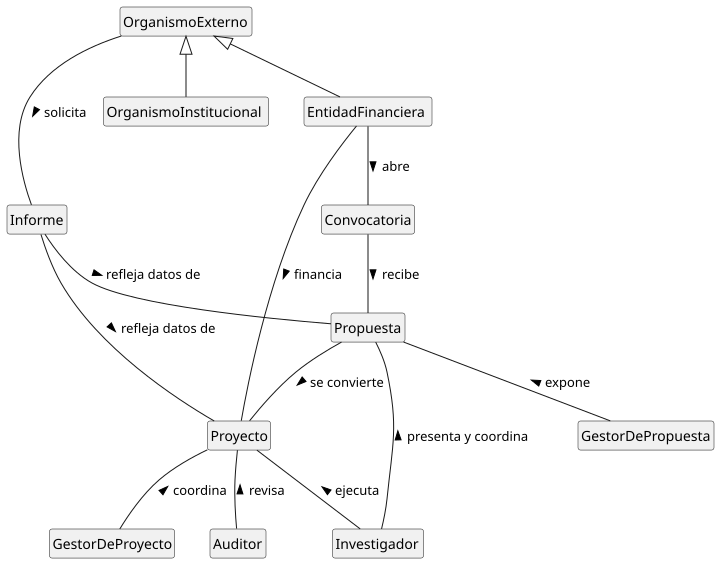
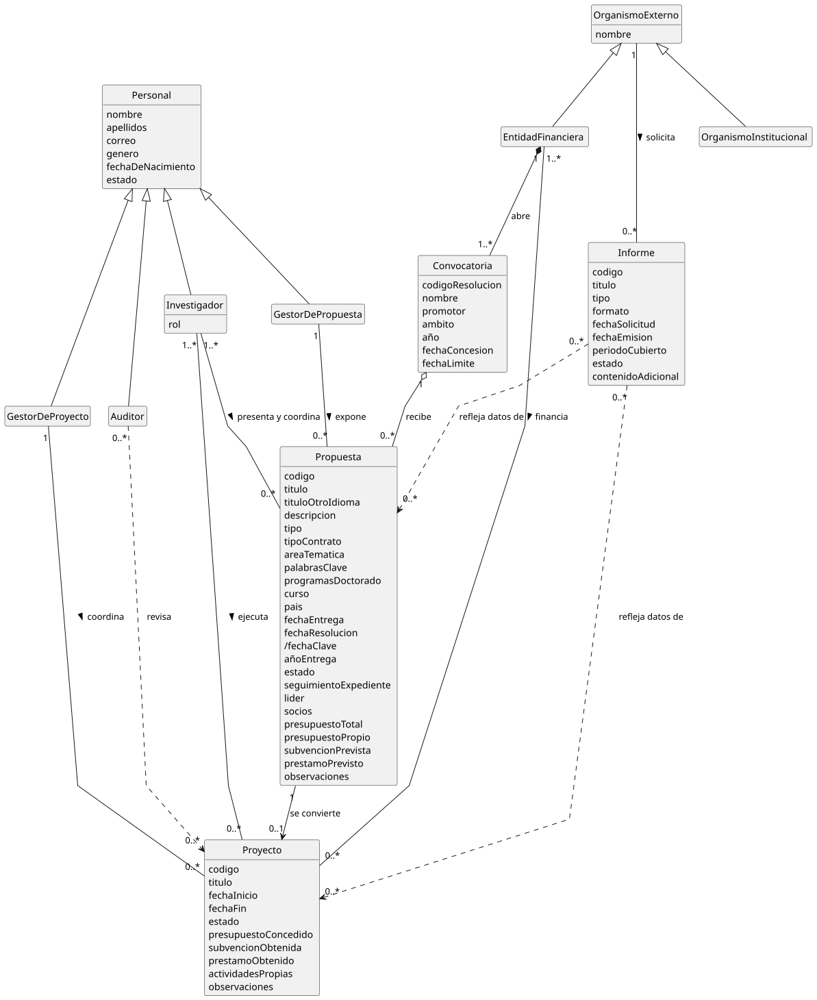
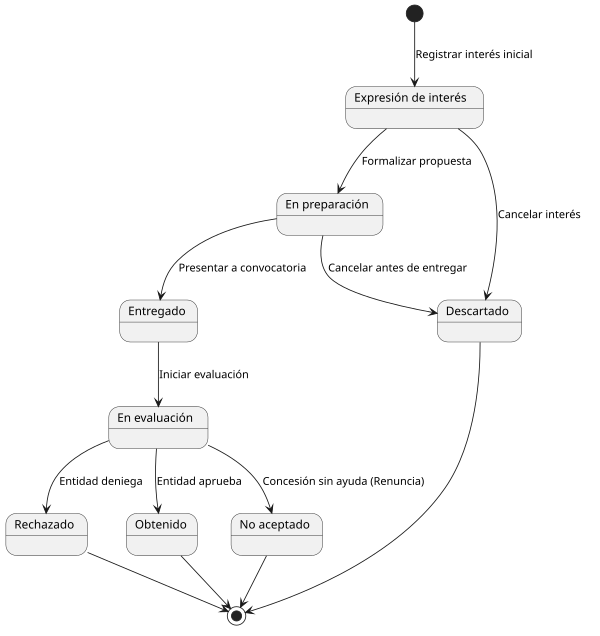
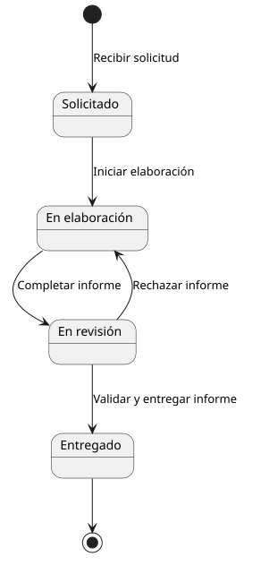

|     
|-:

# Modelo del Dominio

## Información del artefacto
* **Proyecto:** 26-27-IdSw1-SDR · Gestión OTRI
* **Fase RUP:** Inicio (Inception) / Modelo del Dominio
* **Versión:** 1.1
* **Estado:** Validado formalmente

---

## 1. Diagrama de Clases del Negocio

### 1.1. Diagrama de Clases

| Diagrama de Clases |
| :---: |
|  |
| *Fuente: [diagrama-de-clases.puml](/modelosUML/00-modelo-del-dominio/diagrama-de-clases.puml)* |

### 1.2. Diagrama de Clases Formal

| Diagrama de Clases Formal |
| :---: |
|  |
| *Fuente: [diagrama-de-clases-formal.puml](/modelosUML/00-modelo-del-dominio/diagrama-de-clases-formal.puml)* |

---

## 2. Ciclos de Vida y Diagramas de Estados

### 2.1. Estados de la Propuesta
Modela las transiciones que experimenta una propuesta desde su registro preliminar (`EXPRESION_DE_INTERES`), pasando por su entrega formal a convocatoria, hasta su resolución (`OBTENIDO`, `RECHAZADO`, `DESCARTADO`). Al ser aprobada (`OBTENIDO`), pasa a considerarse Proyecto.

| Diagrama de Estados — Propuesta |
| :---: |
|  |
| *Fuente: [diagrama-de-estados-propuesta.puml](/modelosUML/00-modelo-del-dominio/diagrama-de-estados-propuesta.puml)* |

### 2.2. Estados del Informe
Modela el flujo de tramitación de los informes solicitados por organismos externos de acreditación y estadística (`Solicitado` $\rightarrow$ `En Elaboración` $\rightarrow$ `En Revisión` $\rightarrow$ `Entregado`).

| Diagrama de Estados — Informe |
| :---: |
|  |
| *Fuente: [diagrama-de-estados-informe.puml](/modelosUML/00-modelo-del-dominio/diagrama-de-estados-informe.puml)* |

---

## 3. Glosario

### 3.1. Entidades del Dominio

| Entidad | Definición de Negocio |
| :--- | :--- |
| **`Propuesta`** | Iniciativa de investigación postulada a una convocatoria pendiente de resolución. |
| **`Proyecto`** | Propuesta formalmente concedida que cuenta con financiación, cronograma y equipo ejecutor. |
| **`Convocatoria`** | Marco competitivo (regional, nacional o internacional) abierto por una entidad financiadora. |
| **`EntidadFinanciera`** | Organismo externo que oferta fondos públicos o privados y evalúa las propuestas. |
| **`Investigador`** | Personal docente e investigador (PDI) que formaliza la postulación científica y ejecuta los proyectos concedidos. |
| **`Informe`** | Documento estructurado emitido por la OTRI para justificaciones, auditorías o estadísticas. |

### 3.2. Relaciones del Negocio

| Relación | Entidades | Definición y Alcance |
| :--- | :---: | :--- |
| **`presenta y coordina`** | `Investigador` — `Propuesta` | Vincula al investigador con la propuesta. La **presentación** comprende la elaboración y justificación técnica, científica y presupuestaria de la propuesta, mientras que su posterior **coordinación** abarca la articulación del equipo investigador y el seguimiento del expediente durante su tramitación ante la OTRI. |
