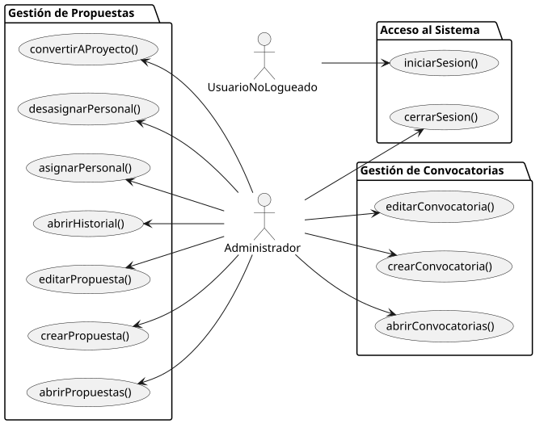
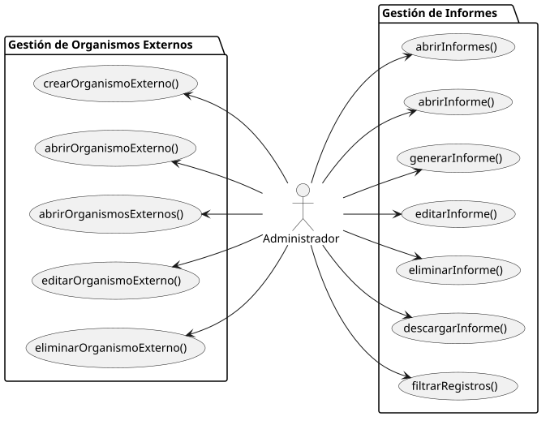
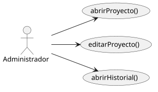

|     
|-:

# Actores y casos de uso

## Información del artefacto
* **Proyecto:** 26-27-IdSw1-SDR · Gestión OTRI
* **Fase RUP:** Inicio (Inception) / Requisitos — Actores y casos de uso
* **Estado:** En curso (Actividad 1)

---

|Propuestas y Convocatorias|Filtrado e Informes|
|:-:|:-:|
|||
|
<i>[Código fuente](/modelosUML/01-actores-casos-uso/dimension-propuesta/actores-casos-uso.puml)</i>
|
<i>[Código fuente](/modelosUML/01-actores-casos-uso/dimension-filtrado-informe/actores-casos-uso.puml)</i>
|

|Proyectos|
|:-:|
||
|
<i>[Código fuente](/modelosUML/01-actores-casos-uso/dimension-proyecto/actores-casos-uso.puml)</i>
|

---

## Diagrama de Contexto

*(En elaboración).*

---

## Inventario por dimensión

| Dimensión | Actores | Paquetes | Casos de uso |
| :--- | :--- | :--- | :--- |
| **Convocatorias y Propuestas** | `UsuarioNoLogueado` `Administrador` | Acceso al Sistema | `iniciarSesion()`, `cerrarSesion()` |
| | `Administrador` | Gestión de Convocatorias | `abrirConvocatoria()`, `abrirConvocatorias()`, `crearConvocatoria()`, `editarConvocatoria()`, `eliminarConvocatoria()` |
| | `Administrador` | Gestión de Propuestas | `abrirPropuesta()`, `abrirPropuestas()`, `crearPropuesta()`, `editarPropuesta()`, `asignarPersonal()`, `desasignarPersonal()`, `concederPropuesta()`, `descartarPropuesta()`, `rechazarPropuesta()`, `entregarPropuesta()` |
| | `Administrador` | Gestión de Persona | `abrirPersona()`, `abrirPersonas()`, `crearPersona()`, `editarPersona()`, `eliminarPersona()` |
| **Proyectos** | `Administrador` | Gestión de Proyectos | `abrirProyecto()`, `abrirProyectos()`, `editarProyecto()`, `finalizarProyecto()`, `abrirHistorial()`, `asignarPersonal()`, `desasignarPersonal()` |
| **Filtrado e Informes** | `Administrador` | Gestión de Organismos Externos | `crearOrganismoExterno()`, `abrirOrganismoExterno()`, `abrirOrganismosExternos()`, `editarOrganismoExterno()`, `eliminarOrganismoExterno()` |
| | `Administrador` | Gestión de Informes | `abrirInformes()`, `abrirInforme()`, `generarInforme()`, `editarInforme()`, `eliminarInforme()`, `descargarInforme()`, `filtrarRegistros()` |

---

## Delimitación de Actores del Sistema

| Actor | Tipo | Descripción y Alcance |
| :--- | :---: | :--- |
| **`UsuarioNoLogueado`** | Humano (Iniciador) | Usuario que accede a la plataforma sin credenciales activas. Su única acción permitida es `iniciarSesion()`. |
| **`Administrador`** | Humano (Principal) | Técnico o gestor de la OTRI autenticado. Tiene el control operativo integral sobre convocatorias, propuestas, proyectos, organismos, informes y directorio de personal. |
